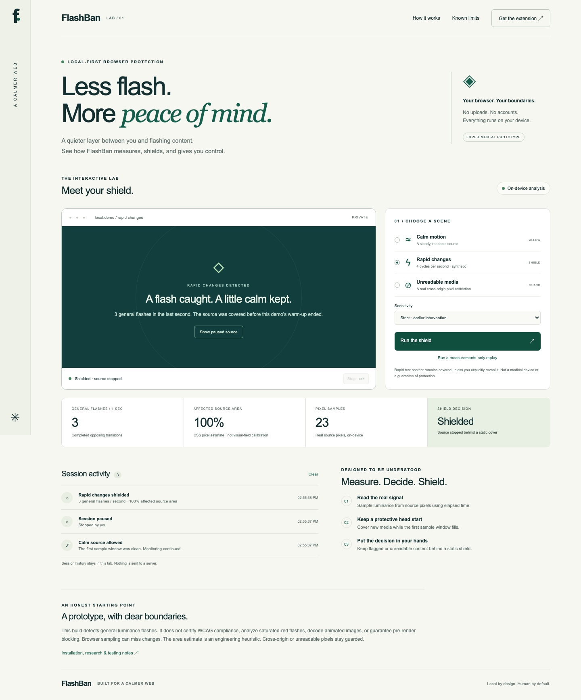

# FlashBan — a calmer web

A fork-only engineering prototype that measures general luminance flashes, guards unreadable media, and puts a static shield between the viewer and flagged content.



## Try the working demo

```sh
cd prototype
npm ci
npx playwright install chromium
npm run build
npm start
```

Open **http://127.0.0.1:8787**. Choose calm, rapid-change or unreadable media. Live measurements come from real pixels; the unreadable scene triggers an actual cross-origin canvas restriction. Rapid sources stay covered during analysis and stop when flagged. A measurements-only replay is available for reduced motion.

The runtime is dependency-free and local. Two loopback ports (8787 and 8788) support the studio and its cross-origin fixture. No account, upload, analytics or reporting service.

## Install the Chrome extension

Open `chrome://extensions`, enable Developer mode, choose **Load unpacked**, and select `prototype/extension`. Then use the studio’s installation page and standalone extension fixture. The extension shares the studio’s detector, covers new sources while sampling, pauses flagged video/CSS, and maintains a bounded local hostname-only event log.

## Watch or download

- [Narrated and captioned walkthrough](prototype/artifacts/flashban-walkthrough.mp4)
- [Captions](prototype/artifacts/flashban-walkthrough.vtt) · [Transcript](prototype/artifacts/transcript.md)
- [Complete prototype ZIP](prototype/artifacts/flashban-prototype.zip)
- [Setup, architecture and limitations](prototype/README.md)
- [Research and design decisions](prototype/RESEARCH.md)

## Validation

**45 unit tests**, **9 studio browser checks**, and **7 installed-extension checks** pass locally. Studio checks include an automated accessibility scan and a mobile viewport. Extension checks exercise actual canvas/CSS/video detection, unreadable-source recovery, local logging and clearing. Browser evidence is saved in `prototype/artifacts`. The fork workflow reruns build, unit tests and browser tests.

```sh
cd prototype
npm test
# with npm start running:
npm run test:browser
node test/extension.mjs
```

## Honest boundaries

Experimental, not a medical device, guaranteed protection, or WCAG certification. General flashes only; saturated-red flashes and animated-image decoding are not implemented. CSS sampling and source-area measurements are approximations. Browser scheduling, initial rendering, compositing, small regions, and adversarial pages can defeat detection or covering. Passing controlled examples does not establish safety on arbitrary websites. See the prototype README for the full limits.

This branch is independent work in `sysoutprntlne/FlashBan`; upstream main and the team PR are untouched. The original hackathon plan and demo fixtures remain in `docs/` and `demo/` for context.
